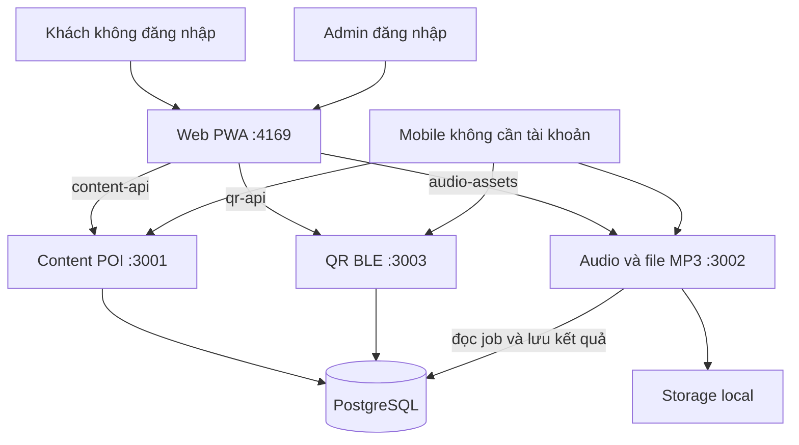

> Cập nhật 25/10/2026: hệ thống chỉ sử dụng [15 POI theo bảng mới](docs/ACTIVE_POIS.md). Các số liệu danh sách cũ bên dưới là lịch sử.

# Smart Audio Guide — Cát Tiên

**Thành viên vừa clone/pull:** bắt đầu tại [hướng dẫn làm việc nhóm](docs/TEAM_SETUP.md). Cài Node.js 24 và Docker Desktop, chạy `npm run dev:full` tại thư mục có file này. Script tự cài backend, tạo database và tài khoản admin riêng, nhập 17 POI/85 bản dịch cùng 16 MP3 Google đã chia sẻ. Không cần khóa Google để nghe các MP3 này. Sau khi cài lần đầu, dùng `git pull --ff-only` để nhận mã mới; đọc hướng dẫn trước khi cập nhật dữ liệu đã chỉnh sửa.

**Chia nhau tạo Google audio:** xem [COLLABORATIVE_AUDIO.md](docs/COLLABORATIVE_AUDIO.md). Mỗi thành viên dùng khóa riêng phía backend, nhận một phần ngôn ngữ bằng `TTS_LANGUAGES`, tạo MP3 rồi commit fixture để cả nhóm pull và nhập bằng `npm run content:seed`.

**Cập nhật Google AI Studio:** đã tích hợp Gemini TTS, kịch bản Word, gói audio tải về, font tiếng Việt và bộ dịch giao diện 5 ngôn ngữ. Hiện có 17 POI và 16 MP3 Google thật; còn 69 bản chưa có MP3. Khi thiếu hoặc MP3 lỗi, web/mobile thử voice hệ thống đúng ngôn ngữ; nếu thiết bị không có voice đó thì báo rõ, không đọc bằng tiếng khác. Xem [tiến độ tạo audio ngày 24/10](docs/GEMINI_AUDIO_PROGRESS.md) và [hướng dẫn Google/ngoại tuyến](docs/GOOGLE_AI_STUDIO_AND_OFFLINE.md). Chạy `npm run dev:gemini:lan` và dùng `?source=api`; các hướng dẫn eSpeak bên dưới là chế độ thay thế.

Hệ thống tham quan gồm web/PWA, backend NestJS/PostgreSQL và mobile Expo. Backend hiện có 17 điểm (demo riêng vẫn 15), 5 ngôn ngữ, sơ đồ, nghe thuyết minh, GPS/QR, gói ngoại tuyến và quản trị.

Đã áp dụng Leaflet/OpenStreetMap và cải thiện giọng trình duyệt từ bản tham chiếu `cat-tien-app`. Trên web, bấm **Bản đồ OpenStreetMap** để đổi từ sơ đồ sang nền địa lý. Xem [chi tiết tích hợp, API, cách dùng và kiểm thử](docs/CAT_TIEN_INTEGRATION.md).

**Phân quyền đúng yêu cầu:** khách sử dụng không cần đăng ký hoặc đăng nhập. Chỉ admin đăng nhập để quản lý; admin vẫn dùng trang Khám phá như khách. Không có chức năng tạo tài khoản cho khách. ENUM EDITOR cũ được giữ để không phá database, nhưng các API quản trị hiện chỉ cho ADMIN.

**Tình trạng:** web/backend đã chạy với database thật và qua kiểm thử tích hợp. Mobile đã build và chạy APK debug x86_64 trên máy ảo Android, sửa lỗi TrackPlayer và Intl.PluralRules. Chưa kiểm chứng đầy đủ trên điện thoại thật, GPS/BLE ngoài thực địa hoặc APK release. Còn 69 bản Google chưa tạo được nên chưa thể coi toàn hệ thống hoàn thiện 100%. Xem [hướng dẫn nhóm và giới hạn hiện tại](docs/TEAM_SETUP.md).

## 1. Chạy hệ thống local miễn phí

Cần Node.js 24 trở lên (đã kiểm tra bằng 24.14.0), Docker Desktop với Linux engine đang chạy. Mở terminal tại thư mục dự án:

```powershell
npm run dev:local-tts
```

Bản này chạy PostgreSQL và engine tạo MP3 miễn phí trên máy; lần đầu cần tải/build Docker image. Nếu chỉ cần MP3 đã có/giọng thiết bị, dùng npm run dev:full nhẹ hơn.

Mở **http://127.0.0.1:4169/?source=api**. Nếu đang ở demo, chọn Kết nối → Backend NestJS → Áp dụng kết nối. Khách xem nội dung, nghe, QR và tải gói không cần tài khoản.

### Quét QR bằng điện thoại cùng Wi-Fi

Dừng phiên đang chạy bằng Ctrl+C. Để dùng Google AI Studio và QR cùng Wi-Fi, chạy:

```powershell
npm run dev:gemini:lan
```

Nếu chủ động muốn dùng eSpeak miễn phí hoàn toàn thay Google, chạy:

```powershell
npm run dev:lan
```

Chỉ chạy một phiên hệ thống. Nếu báo cổng `4169`, `3001`, `3002` hoặc `3003` đang được sử dụng, dừng phiên tại terminal cũ rồi chạy lại. Bộ khởi động kiểm tra các cổng trước khi build và áp dụng database. Xem [cách sửa lỗi khởi động](docs/STARTUP_PORT_FIX.md).

Chế độ này chạy toàn hệ thống với TTS cục bộ và cho phép truy cập web từ mạng nội bộ trong lúc chương trình chạy. Màn hình sẽ in **Điện thoại cùng Wi-Fi: http://<IP-máy-tính>:4169/?source=api**; mở địa chỉ này trên máy tính, bấm **QR Code**, rồi quét bằng điện thoại cùng Wi-Fi. Mã sẽ dùng IP LAN thay vì localhost; địa chỉ có thể thay đổi khi đổi mạng. Nếu Windows hỏi quyền mạng cho Node.js, cho phép trên mạng Private đang dùng. Không cần mở cổng router hoặc tắt tường lửa. Nhấn Ctrl+C để dừng.

Nếu có nhiều card mạng hoặc đã lưu một URL QR khác, kiểm tra ô **Địa chỉ web tham gia**, nhập đúng địa chỉ cùng mạng điện thoại rồi bấm **Cập nhật mã QR**. `PUBLIC_WEB_URL` có thể dùng để chỉ định URL cần in vào QR. Chế độ thông thường `dev:local-tts` vẫn chỉ nghe trên localhost nếu không đặt HOST riêng.

Trên điện thoại qua HTTP LAN, trang, MP3 và QR tham gia có thể dùng; GPS, quét camera trong web và cài PWA cần HTTPS. Có thể dùng camera hệ thống của điện thoại để quét QR mở trang. Kiểm thử từ máy tính không thay thế việc kiểm tra trên điện thoại hoặc cấu hình Wi-Fi có cô lập thiết bị.

**Giọng đọc hiện tại:** nguồn tự động ưu tiên MP3 Google AI Studio đã sẵn sàng; nếu thiếu hoặc MP3 lỗi, ứng dụng thử giọng thiết bị đúng ngôn ngữ. Thiết bị cần có voice tương ứng; nếu không, ứng dụng báo rõ và không đọc bằng ngôn ngữ khác. Hiện có 16 MP3 cho 85 bản thuyết minh. Xem [Google AI Studio và ngoại tuyến](docs/GOOGLE_AI_STUDIO_AND_OFFLINE.md); [VOICE_FIX.md](docs/VOICE_FIX.md) ghi lại lần sửa nguồn giọng trước đó.

Lần đầu cần mạng tải image PostgreSQL/thư viện. Script tự build, áp dụng migration bổ sung, seed các POI chưa có, tạo QR và chuẩn bị admin local. Không xóa hoặc ghi đè nội dung POI đã chỉnh sửa.

Admin: mở **Kết nối → Đăng nhập quản trị**, nhập tài khoản được tạo ở:

```text
backend/.runtime/admin-login.txt
```

Mật khẩu ngẫu nhiên được giữ riêng trong file này, không đưa vào README/log. Không chia sẻ file và không commit thư mục .runtime. Những lần khởi chạy sau giữ nguyên tài khoản/mật khẩu. Nếu cần đặt lại admin local, dùng ADMIN_EMAIL/ADMIN_PASSWORD (ít nhất 12 ký tự) theo hướng dẫn trong báo cáo.

```powershell
# Dừng ứng dụng: Ctrl+C tại terminal đang chạy.
# Dừng database và giữ dữ liệu:
npm run infra:stop
```

Không dùng `down -v` để sửa lỗi thông thường vì sẽ xóa volume database.

Để chỉ xem demo không cần database:

```powershell
npm run dev
```

Demo chỉ là dữ liệu trải nghiệm trong trình duyệt. Giao diện quản trị thật yêu cầu backend và đăng nhập admin.

## 2. Cách hệ thống hoạt động



Bản local cơ bản chỉ cần PostgreSQL. Chế độ dev:local-tts thêm engine eSpeak NG/FFmpeg local ở cổng 3010, không gọi cloud. Job audio nằm trong bảng tts_jobs và được worker lấy xử lý; không cần RabbitMQ/Redis/MongoDB để khởi động. Cache POI nhỏ nằm trong tiến trình; revision trong PostgreSQL là nguồn chuẩn.

Quản trị lưu POI/bản dịch. Chế độ dev:gemini tạo MP3 qua AI Studio và lưu provider/voice; dev:full dùng DEVICE, không gọi TTS ngoài. MP3 READY được đưa vào gói offline. Sửa lời thuyết minh làm MP3 cũ hết hiệu lực để tránh nghe sai nội dung.

| Thành phần | Cổng | Vai trò |
| --- | --- | --- |
| Web | 4169 | Khách, quản trị, proxy API/audio, PWA |
| Content | 3001 | POI, xác thực admin, cấu hình, tracking, analytics |
| Audio | 3002 | MP3 Google/LOCAL/upload và worker PostgreSQL có tạm dừng quota |
| QR/BLE | 3003 | Tra token/registry của điểm đã xuất bản |
| PostgreSQL | 5432 | Nội dung, admin, job, thống kê, revision, audit |

## 3. Những lựa chọn không cần mua API

| Nhu cầu | Giải pháp hiện tại | Giới hạn |
| --- | --- | --- |
| Database/queue | PostgreSQL local | Máy chủ cần bật khi dùng online |
| Sơ đồ/tìm tuyến | SVG và graph Dijkstra có sẵn | Chỉ là sơ đồ, khoảng cách còn ước lượng |
| Bản đồ native | MapLibre, không cần token Mapbox | Basemap demo không phải dữ liệu đường rừng chi tiết |
| Nghe online | Web Speech / expo-speech | Phụ thuộc giọng trên thiết bị; có thể cần mạng |
| Nghe offline | MP3 Google AI Studio đã lưu; LOCAL hoặc thu âm là lựa chọn khác | Có 16 MP3 Google được chia sẻ, còn 69 bản chưa tạo; có gói PWA và ZIP |
| Lưu audio | File local | Cần sao lưu cùng database |
| QR | SVG tạo tại client | Không cần dịch vụ tạo QR bên ngoài |
| Bảo vệ đồ án | Laptop/LAN, build Android local | Không cần hosting hoặc build cloud trả phí |

`npm run dev:full` ép DEVICE để tránh vô tình dùng Google từ env cũ. Nếu chủ động muốn Google, cấu hình key/billing và chạy `npm run dev:full -- --cloud-tts`; đây là Google Cloud TTS cũ, khác Gemini AI Studio đã kiểm chứng bằng audio thật trong cập nhật mới nhất. DEVICE không sinh MP3 ở server. Chế độ LOCAL đã tổng hợp thành công cả Việt/Anh/Nhật/Trung/Hàn bằng eSpeak NG + FFmpeg. Sau khi mở dev:local-tts, chạy npm run audio:generate để tạo những audio còn thiếu; script giữ nguyên MP3 READY đã có và không cho dùng provider trả phí. Đã tạo đủ 75 MP3 mẫu (15 mỗi tiếng); không coi đây là giọng đã được biên tập/duyệt chất lượng.

## 4. Quản trị nội dung và MP3

1. Đăng nhập admin, mở Quản trị. Có thể tạo audio theo provider đang chạy (Gemini hoặc LOCAL), hoặc tải bản thu âm. Gemini đang hết quota thì nút báo tạm dừng.
2. Thêm/sửa điểm; nhập tọa độ, sơ đồ và bản dịch cần có. Mã điểm/bản đồ cố định sau khi tạo để giữ đúng đồng bộ offline.
3. Chỉ đánh dấu GPS đã xác thực khi đã kiểm chứng tọa độ thật.
4. Chọn **Tải MP3** ở dòng POI, chọn ngôn ngữ/giọng và file MP3 (tối đa 20 MB).
5. Mở Khám phá, chọn đúng điểm/ngôn ngữ và kiểm tra nghe MP3.
6. Bấm Lưu để dùng ngoại tuyến, chờ tải xong; thử ngắt mạng và tải lại trang. Chỉ audio đã có/tải thành công mới bảo đảm dùng được.
7. Sửa script thì cần tải MP3 tương ứng mới. Giọng thiết bị không tự được đóng gói thành file.

Trong Quản trị có mục tải QR/beacon/job/nhật ký, tải SVG QR từng điểm, bật/tắt token, đăng ký/bật/tắt beacon, cấu hình bán kính/cooldown và xem tổng hợp vùng vị trí đã được khách đồng ý chia sẻ. Giao diện có heatmap màu theo lưới tọa độ và bảng số mẫu; không phải lớp bản đồ đường đi thực địa.

## 5. Database và migration

- Schema đầu: backend/db/schema.sql (15 bảng).
- Analytics: backend/db/analytics.sql (2 bảng).
- Migration mới: backend/db/complete.sql (content_clock, schema_migrations, location_pings và các cột job/audio/session cần thiết).
- Tổng cộng 20 bảng khi áp dụng đầy đủ; [ERD](docs/ERD.md), [API](docs/API.md).

Docker init SQL chỉ chạy lúc volume trống. dev:full luôn áp dụng các migration bổ sung idempotent cho DB cũ, không chạy lại toàn bộ schema.sql. Đừng chạy schema.sql lên DB có dữ liệu.

```powershell
npm run backup
```

Backup database và storage nằm trong backend/.runtime/backups/. Đã thử restore vào database kiểm thử riêng và đọc được 15 POI published cùng 75 MP3 READY. Không restore đè database chính để kiểm tra backup.

## 6. Điện thoại và mobile

Web qua LAN: thay IP bằng địa chỉ laptop của bạn:

```powershell
$env:HOST = '0.0.0.0'
$env:PUBLIC_WEB_URL = 'http://192.168.1.12:4169/'
npm run dev:full
```

Camera/GPS/PWA qua điện thoại thường cần HTTPS. QR không được chứa localhost. Proxy audio cùng origin giúp tránh MP3 trỏ nhầm localhost của điện thoại. Dịch vụ backend mặc định chỉ lắng nghe loopback; nếu native truy cập trực tiếp từ điện thoại, đặt API_HOST=0.0.0.0 và giới hạn firewall cho LAN.

```powershell
Copy-Item mobile/.env.example mobile/.env
cd mobile
npm ci
npx expo install --check
npx tsc --noEmit
npx expo prebuild --platform android --no-install
npx expo run:android
```

Cần Android SDK/emulator hoặc máy Android USB; APK debug x86_64 đã được build/cài và chạy trên máy ảo. Không dùng Expo Go. Emulator dùng 10.0.2.2, máy thật dùng IP LAN cho API và ASSET_BASE trong .env. Xem [hướng dẫn Android Studio](docs/BUILD_ANDROID_STUDIO.md); native project được tạo lại bằng Expo prebuild và không chứa đường dẫn SDK của máy tác giả.

MapLibre mặc định dùng demotiles cho phát triển; sơ đồ là bản đồ chi tiết sẵn có khi offline. Chỉ bật EXPO_PUBLIC_OFFLINE_MAP_STYLE với nguồn do mình cung cấp hoặc được phép tải trước; không tải hàng loạt tile OSM công cộng.

Đã bổ sung task auto-play nền từ MP3 đã tải và cooldown lưu bền vững. Cần thử trên thiết bị: foreground, background, khóa màn hình và quyền vị trí. Không hứa chạy khi người dùng force stop app. BLE/iBeacon hiện vẫn ưu tiên Android; iOS chưa có triển khai ranging tương đương.

## 7. Kiểm tra lại

```powershell
npm test
npm --prefix backend run build
npm --prefix backend test -- --runInBand
npm --prefix mobile test -- --runInBand
# Cần dev:full đang sẵn sàng:
npm run test:integration
npm run test:analytics
npm run test:complete
```

Hiện đạt 33 test web, 17 test backend, 15 test mobile; các kịch bản CRUD/analytics và bộ nghiệm thu mở rộng được ghi trong [báo cáo thay đổi](docs/CHANGES_AND_STATUS.md). Test MP3 dùng fixture cấu trúc khung MPEG để kiểm tra upload/proxy; không thay đánh giá chất lượng giọng đọc.

Đã nâng runtime backend lên NestJS 12.2 và kiểm thử lại; npm audit --omit=dev hiện báo 0 cảnh báo backend. Còn cảnh báo trong công cụ phát triển/Expo/Jest, được ghi rõ trong báo cáo. Không coi đây là bản đã được duyệt để đưa public/production. Lần kiểm tra cũ đã lưu 75 MP3 eSpeak. Bản mới đã lưu 11 MP3 Google, dừng máy chủ, tải lại 17 POI và phát Bàu Sấu từ cache thành công. Còn cần tọa độ thực địa, nội dung/audio được nghe duyệt và kiểm thử thiết bị để xác nhận đầy đủ yêu cầu môn học.
