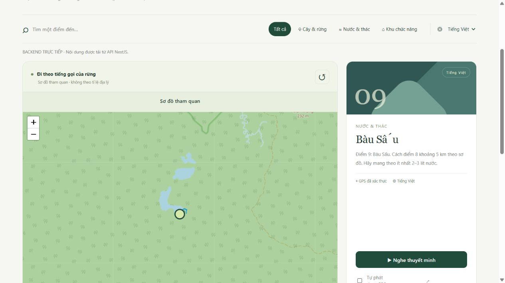

# Tích hợp từ cat-tien-app — 23/10/2026

**Cập nhật giọng đọc:** mặc định web nay ưu tiên Web Speech và chọn giọng đúng thứ tự cat-tien-app, thay cho việc ưu tiên MP3/local voice mô tả trong báo cáo tích hợp ban đầu bên dưới. Người dùng có thể chọn MP3 riêng. Xem [bản sửa và cách sử dụng hiện tại](VOICE_FIX.md); web hiện đạt 29/29 kiểm thử.

## Đã đọc nguồn nào?

Thư mục tham chiếu: `C:/Users/Home/Desktop/CNPM/cat-tien-app/cat-tien-app`.
Đã đối chiếu `js/config.js`, `js/map/leaflet-map.js`, `js/core/audio.js`, `js/media/ai-voice.js`, `js/dev/real-route.js`, `scripts/gen-audio.js`, server và README. Thư mục tham chiếu được giữ nguyên.

## API và cách áp dụng

| Thành phần nguồn | Cách áp dụng vào hệ thống hiện tại | Chi phí/điều kiện |
| --- | --- | --- |
| Leaflet 1.9.4 + OpenStreetMap | Thêm bản đồ địa lý vào trang web, chuyển qua lại với sơ đồ; có chọn POI, lọc, vị trí GPS và vòng sai số | Không cần API key; nền OSM cần mạng, tuân thủ chính sách dịch vụ cộng đồng |
| Web Speech API | Chờ danh sách giọng khi tải bất đồng bộ; chọn đúng locale trước, ưu tiên giọng cài trên máy trong cùng locale; chặn phát trễ sau khi đã dừng/chuyển điểm | Không cần tài khoản/key; giọng có sẵn tùy thiết bị và trình duyệt |
| MP3 trước, giọng trình duyệt dự phòng | Giữ cơ chế MP3 từ database/backend trước; nếu tải/phát MP3 lỗi thì dùng giọng trình duyệt | Gói MP3 đã tải dùng được ngoại tuyến |
| Google Cloud Text-to-Speech `POST /v1/text:synthesize` | Backend đã có provider cùng API; giữ nguyên tích hợp phía máy chủ, không chép script sinh file hoặc đưa key ra web | Có thể phát sinh phí; chỉ bật bằng cấu hình cloud có chủ ý |
| Engine TTS cục bộ hiện có | Giữ làm phương án tạo MP3 miễn phí mặc định bằng eSpeak NG/FFmpeg | Chạy trên máy qua Docker; chất lượng giọng cơ học |
| Overpass API trong trình giả lập | Chưa đưa vào luồng chỉ đường của khách: kết quả OSM là các đoạn đường, chưa bảo đảm tuyến nối được và phù hợp đi bộ trong vườn | Dịch vụ công có giới hạn; không thể suy ra chỉ đường thực địa tin cậy |
| `/api/stats`, presence và tài khoản dashboard của bản tham chiếu | Tiếp tục dùng API thống kê PostgreSQL và xác thực admin của hệ thống hiện tại | Không tạo backend hoặc cơ chế mật khẩu thứ hai |

Ứng dụng mobile tiếp tục dùng MapLibre đã tích hợp. Leaflet dành cho DOM của web, không cài trực tiếp vào React Native. Bản đồ native, GPS và phát nền vẫn cần kiểm tra trên thiết bị thật.

## Các thay đổi cụ thể

- `web/outdoor-map.mjs`: adapter Leaflet; chỉ hiển thị POI có GPS được xác thực và giá trị hợp lệ. Không chuyển tọa độ sơ đồ ước lượng thành điểm GPS thật.
- `web/browser-tts.mjs`: chọn giọng, chờ `voiceschanged` có thời hạn, gỡ listener sau khi hoàn thành.
- `web/app.mjs`: nối bản đồ với chọn điểm/bộ lọc/GPS; chuyển về sơ đồ khi tìm tuyến; bảo vệ lượt TTS khỏi kết quả chờ đã lỗi thời.
- `web/index.html`, `web/styles.css`: nút “Bản đồ OpenStreetMap”, vùng bản đồ, trạng thái tải.
- `web/vendor/leaflet/`: lưu thư viện 1.9.4 và giấy phép tại dự án; đã so khớp SHA-256 của JS/CSS với tài liệu chính thức. Người dùng không cần tải thư viện từ CDN khi mở ứng dụng.
- `web/build.mjs`, `web/sw.js`: đóng gói module mới và thư viện vào shell ngoại tuyến v4. Không tải trước hoặc lưu hàng loạt ảnh nền OSM; gói ngoại tuyến vẫn dựa vào sơ đồ và MP3.
- `web/server.mjs`: cho phép ảnh từ đúng host `tile.openstreetmap.org`, gửi Referer ở mức origin cho yêu cầu khác nguồn. Script vẫn chỉ tải từ chính ứng dụng.
- Không cần migration database mới: sử dụng các trường `lat`, `lng`, `geoVerified`, audio, bản dịch và phân quyền đã có.

## Cách sử dụng

1. Mở Docker Desktop, chạy tại thư mục dự án:

   ```powershell
   npm run dev:local-tts
   ```

2. Mở `http://127.0.0.1:4173/?source=api`. Không cần tài khoản để dùng trang Khám phá.
3. Bấm **Bản đồ OpenStreetMap** để xem nền địa lý; bấm **Sơ đồ tham quan** để quay lại. Nút **Tìm đường** mở tuyến trên sơ đồ.
4. Bấm **Bật GPS** và tự cấp quyền nếu muốn hiển thị vị trí. HTTPS hoặc localhost là cần thiết cho GPS. Vị trí chỉ gửi về thống kê khi người dùng đồng ý riêng.
5. Chọn ngôn ngữ và **Nghe thuyết minh**: ưu tiên MP3; nếu không có hoặc MP3 lỗi, dùng Web Speech API. Cài thêm giọng của ngôn ngữ đó trên thiết bị nếu cần.
6. Admin đăng nhập ở Kết nối để sửa tọa độ; chỉ đánh dấu xác thực sau khi đã kiểm tra nguồn/khảo sát. Hiện chỉ 1/15 điểm được đánh dấu, nên bản đồ địa lý không hiển thị đủ 15 marker. Khách vẫn xem đủ điểm trên sơ đồ.
7. Để tạo MP3 mới bằng engine miễn phí, dùng chức năng TTS cục bộ trong quản trị hoặc `npm run audio:generate` khi hệ thống đang chạy với LOCAL. Chế độ này không gọi Google TTS.

Sau khi cập nhật từ bản cũ, tải lại trang; nếu trình duyệt vẫn dùng shell cũ, đóng các tab ứng dụng rồi mở lại để worker v4 hoạt động.

## Kiểm chứng lần tích hợp này

| Kiểm tra | Kết quả |
| --- | --- |
| `npm test` | 27/27 đạt, gồm 5 kiểm thử mới cho GPS, chọn giọng/chờ giọng, tính toàn vẹn Leaflet; bổ sung kiểm tra header HTTP |
| `npm run test:complete` | 15 nhóm tích hợp API/database đạt: khách không đăng nhập, admin, MP3, QR, đồng bộ, thống kê và thu hồi phiên |
| Trình duyệt tại `127.0.0.1:4173` | Trang lấy 15 POI từ backend; chuyển sang Leaflet, tải nền OSM, có ghi nguồn và báo 1/15 điểm xác thực |
| GPS thật, chất lượng nghe và native | Chưa đo thực địa hoặc kiểm chứng chất lượng từng giọng trên mọi thiết bị trong lần này |

Đã kiểm tra thêm trên giao diện: lọc cây/rừng chỉ còn 10 điểm và 0 marker xác thực; bỏ lọc trở lại 15 điểm và marker Bàu Sấu; bấm Tìm đường chuyển về sơ đồ và hiển thị tuyến ước lượng.



## Hệ thống đã hoàn thiện chưa?

Web/backend đã chạy và tích hợp được phần phù hợp của bản tham chiếu. Không cần mua dịch vụ để demo với OSM, TTS cục bộ và giọng thiết bị. Chưa thể gọi toàn hệ thống hoàn thiện 100%: 14 tọa độ còn cần xác thực, tuyến thực địa chưa đủ, chưa có APK/kiểm thử native và phát nền trên thiết bị thật. Nội dung thuyết minh, phát âm và tài liệu nguồn vẫn cần được rà soát trước khi phát hành.

OSM là dịch vụ cộng đồng, không bảo đảm khả dụng. Khi mất mạng, dùng sơ đồ đã lưu; không dùng chức năng tải gói để tải trước nền OSM. Không tự sao chép phần nội dung sách từ bản tham chiếu vì README nguồn nêu cần xin phép trước khi phát hành.

## Tài liệu đã đối chiếu

- [Leaflet Quick Start](https://leafletjs.com/examples/quick-start/): bản đồ, tile layer, marker, ghi nguồn và hash thư viện.
- [OpenStreetMap Tile Usage Policy](https://operations.osmfoundation.org/policies/tiles/): URL HTTPS, ghi nguồn, Referer, cache HTTP và giới hạn tải trước.
- [MDN voiceschanged](https://developer.mozilla.org/en-US/docs/Web/API/SpeechSynthesis/voiceschanged_event): giọng trình duyệt có thể xuất hiện sau khi khởi tạo.

Xem thêm [README](../README.md), [API hiện tại](API.md) và [báo cáo tổng thể](CHANGES_AND_STATUS.md).
