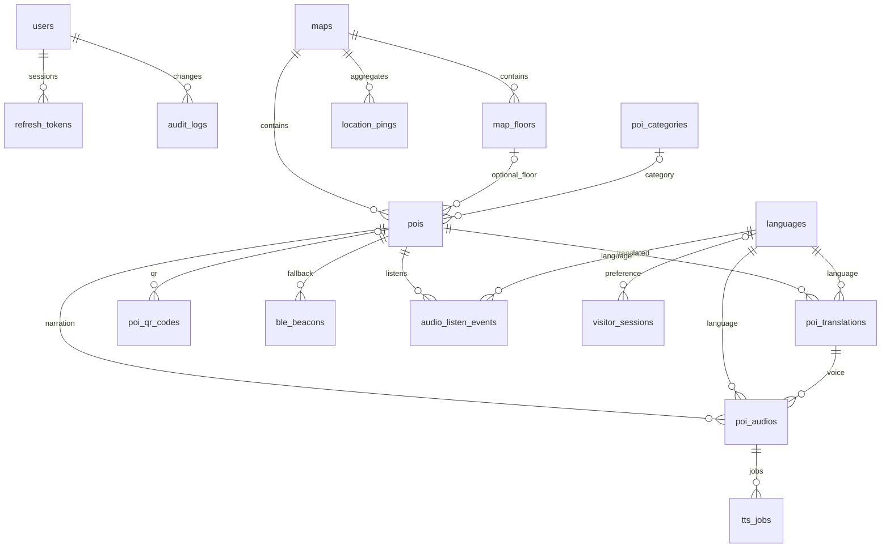

# Database và ERD hiện tại

PostgreSQL là nguồn chính. Schema gốc có 15 bảng, analytics thêm 2, complete.sql thêm 3: tổng **20 bảng** khi áp dụng đủ. Migration mới idempotent và không xóa POI/password đã có.

| Bảng | Vai trò |
| --- | --- |
| languages | Năm ngôn ngữ và TTS locale |
| users | Tài khoản quản trị; không dùng cho khách |
| refresh_tokens | Phiên admin, token hash, hạn và thu hồi |
| visitor_sessions | Phiên khách ẩn danh; presence cập nhật |
| maps, map_floors, poi_categories | Bản đồ/tầng/nhóm; dữ liệu mẫu một khu |
| pois | POI, GPS verified flag, tọa độ sơ đồ, soft delete, revision |
| poi_translations | Nội dung từng tiếng, text hash |
| poi_audios | MP3 theo tiếng/giọng, nguồn, trạng thái, URL, current_job_id |
| tts_jobs | Payload, status, attempts, lease, thời điểm retry và lỗi |
| poi_qr_codes, ble_beacons | Mã tra cứu và beacon đăng ký |
| app_configs | Radius, cooldown, giờ mở cửa, ngôn ngữ; tts_provider public lấy từ env runtime |
| audit_logs | User, thao tác, entity/path và thời gian; không lưu mật khẩu/token |
| web_presence | session/visitor ẩn danh và heartbeat 90 giây |
| audio_listen_events | event ID chống trùng, POI/lang, thời điểm nhận |
| content_clock | Một hàng khóa để serialize writer; revision và nội dung commit cùng transaction |
| schema_migrations | Đánh dấu migration complete đã áp dụng |
| location_pings | Vị trí khách đã consent, dữ liệu phục vụ tổng hợp ô; giữ tối đa 7 ngày qua worker |

web_presence/visitor_sessions/location_pings dùng định danh ẩn danh, không FK tới users. location_pings có FK map_id; audio_listen_events có FK POI/lang. current_job_id dùng so khớp job hiện hành; quan hệ job -> audio có FK/cascade.

content_rev sequence cũ được giữ để tương thích migration và lấy giá trị khởi tạo clock; code mới dùng content_clock. Mọi ghi POI/audio đi qua contentWrite; manifest dùng REPEATABLE READ để tránh mất delta khi có ghi đồng thời.

Không cần Redis/Mongo/RabbitMQ ở runtime local mới. Các container legacy còn được giữ trong Compose nhưng không khởi chạy mặc định. Engine local TTS là container stateless tùy chọn; file audio được lưu bởi audio service ở backend/storage, cần backup cùng PG.

Schema hiện chưa có bảng đường mòn/hiệu chỉnh sơ đồ riêng: graph và phép chiếu còn ở mã nguồn. Các tọa độ chưa kiểm chứng không được đổi thành verified chỉ để đáp ứng số lượng test.
