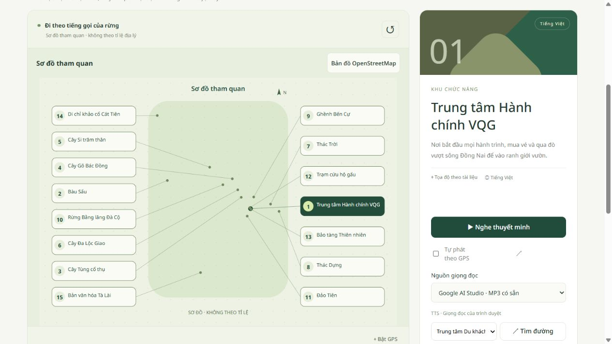
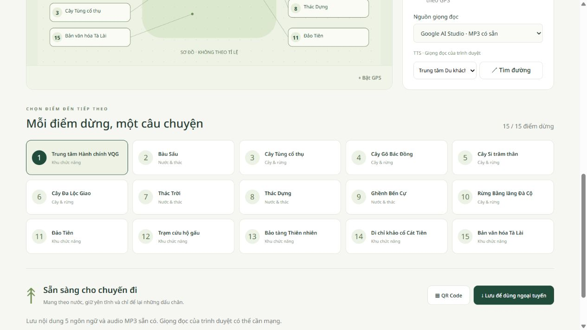

# Sửa số biểu tượng và sơ đồ — 25/10/2026

## Nguyên nhân

Giao diện dùng mã dữ liệu (`coord-01`, `doc-13`...) làm nội dung ô tròn nên chữ tràn và xuống dòng. Sơ đồ cũ chỉ có vị trí vẽ tay của chín điểm còn trùng; sáu điểm mới chưa có vị trí sơ đồ. Các đường nối cũ bị đứt sau khi loại tám điểm khỏi danh sách.

## Bản sửa

- Dùng `sortOrder` làm số hiển thị 1–15 trên thẻ điểm, bảng chi tiết, nhãn sơ đồ, chú thích OpenStreetMap và mục chọn điểm xuất phát. Không đổi mã dữ liệu, UUID, QR hoặc liên kết audio.
- Dựng sơ đồ từ tọa độ GPS của toàn bộ 15 điểm. Các tên được tách thành hai cột nhãn; đường mảnh nối nhãn tới vị trí tương ứng để phân biệt các điểm gần trụ sở. Đây là đường dẫn nhãn, không phải đường đi.
- Bỏ sông, điểm trung tâm phụ và các đoạn đường trang trí của sơ đồ cũ. Không tự tạo tuyến đi bộ mới. Tuyến người dùng yêu cầu chỉ được vẽ nếu đồ thị hiện có chứa tuyến đó; dữ liệu tuyến hiện chưa đầy đủ cho mọi cặp điểm.
- Tiêu đề cho biết chế độ bản đồ hiện tại, nút bên cạnh dùng chuyển sang chế độ còn lại. Bộ lọc và lựa chọn điểm được giữ khi chuyển chế độ.
- Gói giao diện ngoại tuyến được nâng lên `sag-shell-v10` và thêm module sơ đồ mới. Không xóa cache MP3 hay gọi Google tạo âm thanh.

## Kiểm chứng

40/40 kiểm thử web tại thư mục gốc và 42/42 tại thư mục GitHub đạt. Đã kiểm tra trên trình duyệt: đủ 15 nhãn; chọn Trung tâm Hành chính hiển thị 01 và vẫn giữ URL `poi=coord-01`; OpenStreetMap hiển thị 15/15; lọc cây còn 5/5 và sơ đồ vẫn giữ các số 3, 4, 5, 6, 10; đổi sang tiếng Anh cập nhật tên và tiêu đề đúng.

Bản sửa được chia theo module cho lần cập nhật GitHub ngày 26/10/2026; xem MODULE_DELIVERY.md. Phiên web kiểm tra cổng 4174 được dừng sau khi hoàn tất.

## Xem bản mới

Dừng phiên hệ thống cũ bằng Ctrl+C tại terminal đang chạy, rồi chạy lại `npm run dev:gemini:lan` trong thư mục đang dùng. Mở trang và nhấn Ctrl+F5 để nhận giao diện mới. Nếu đang dùng nội dung ngoại tuyến, lưu lại gói sau khi trang đã cập nhật.

